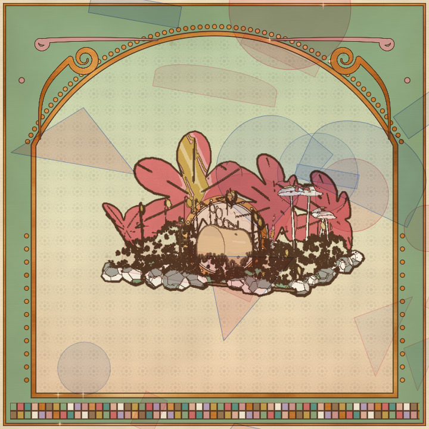
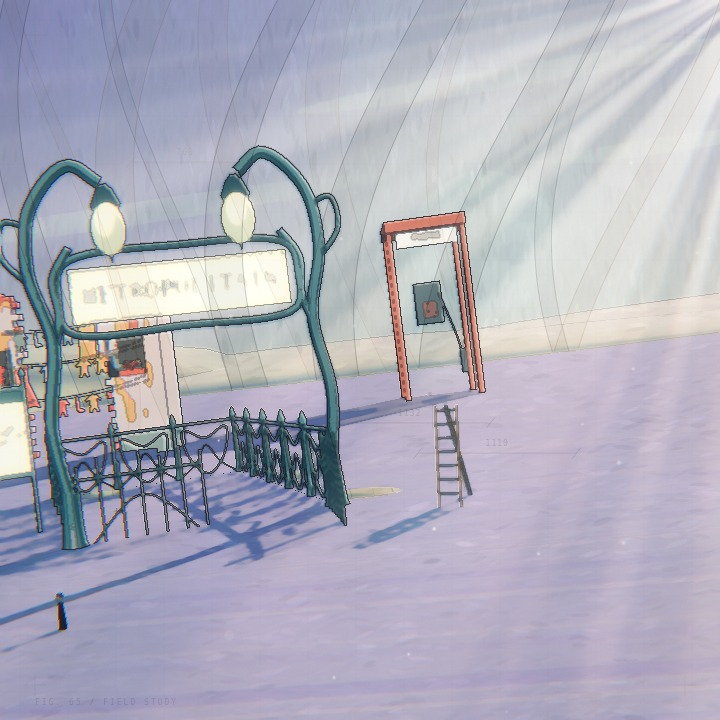
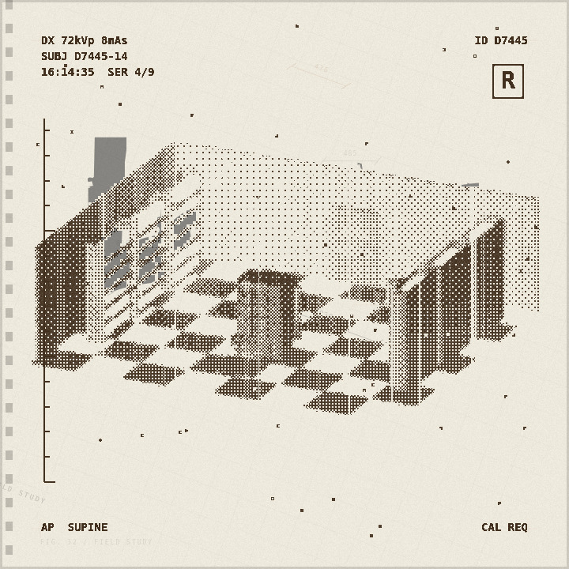
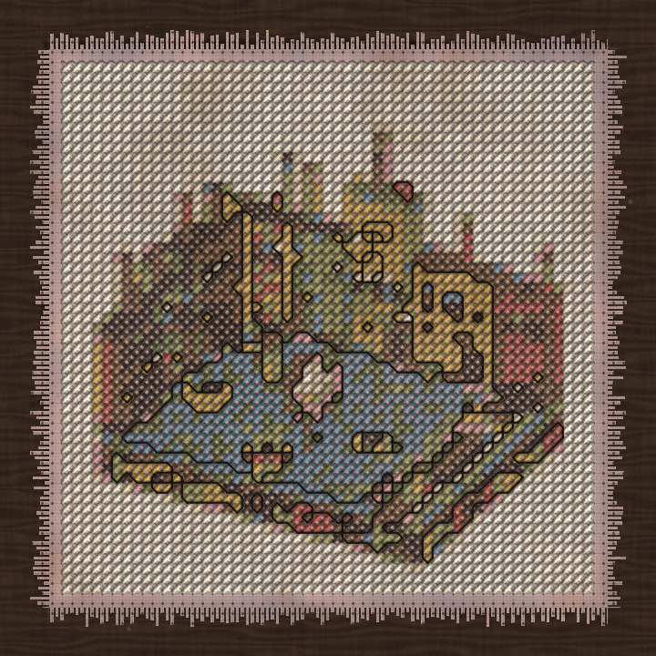
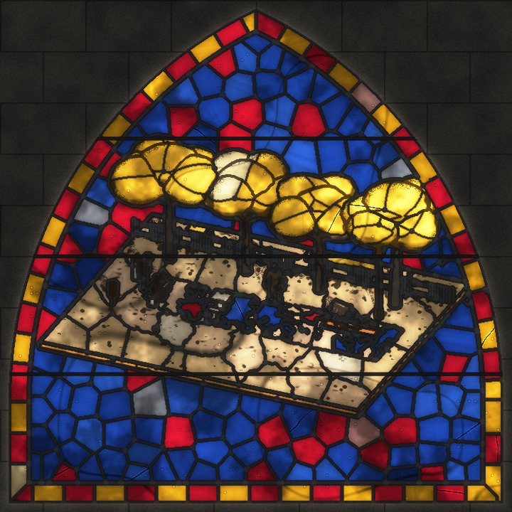
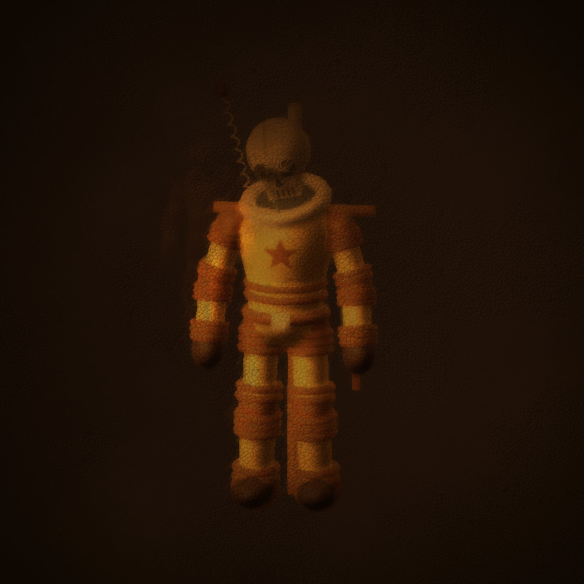
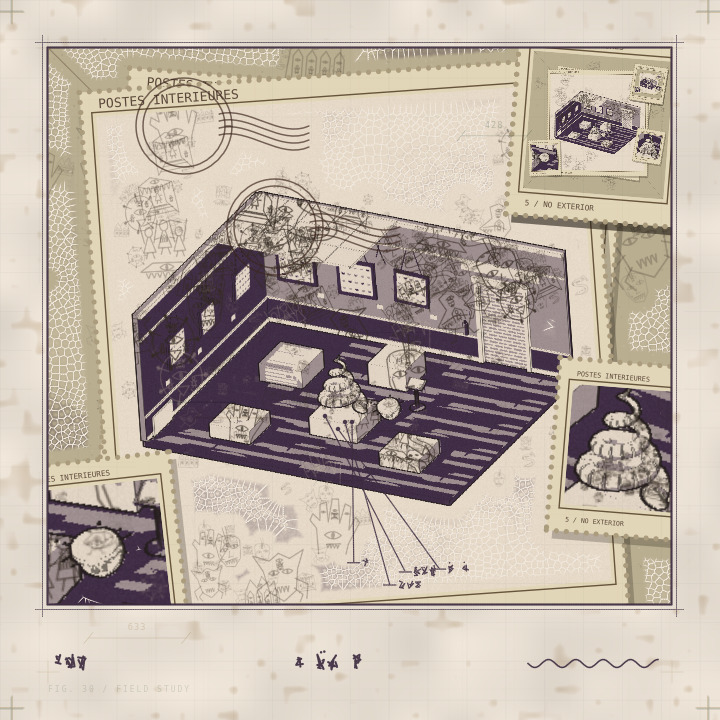
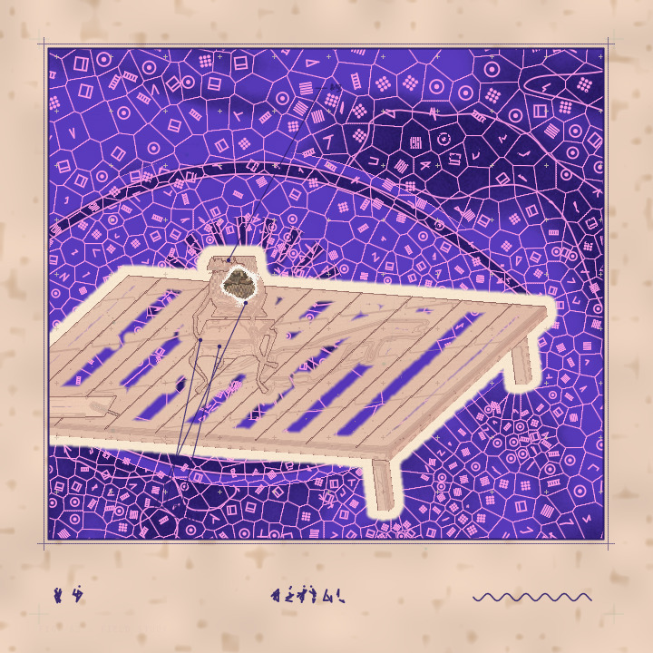

# Conjure

Type an idea or a mood. A decision model picks from an inventory of worlds, things, looks and
directions, and the scene is built in Three.js and printed in a few seconds.

"the last bus home after a funeral" came back as a folding steel chair with a blanket beside a
roadside memorial, on slate under cool late light, drawn as luminous contours over a woodcut.

<p align="center">
  
  
  
  
  
  
  
  
</p>

Everything that can appear in a picture is a self-contained component in its own folder. At the
time of writing (2026-10-21) there are 247 worlds, 1,600 things, 62 looks and 5 directions, all
procedural geometry and pixels, no downloaded models or textures. The catalogue is meant to keep
growing, and the most useful thing to add is a Three.js object or scene: see
[CONTRIBUTING.md](CONTRIBUTING.md) and [COMPONENTS.md](COMPONENTS.md). More pictures are in
[docs/gallery](docs/gallery/README.md).

## Run

Requires Node.js 22.12+.

```bash
npm install
cp .env.example .env     # add a decision-model API key; everything else works without one
npm run dev              # http://localhost:3400
```

The decision model answers typed questions with probabilities, never with text (the System One
protocol), so an idea costs a fraction of a cent and every decision can be inspected and pinned.
Any host of that protocol will do, and any number at once; set the key of each in `.env`:

| Provider | Key | Models |
| --- | --- | --- |
| [TypeSafe AI](https://typesafe.ai) directly | `TYPESAFE_API_KEY` | `jev-latest`, `jev-preview` (Jev, $0.042 per million input tokens) |
| [OpenRouter](https://openrouter.ai/models?output_modalities=decisions) | `OPENROUTER_API_KEY` | every decision model it lists: Jev, Liquid d1, Perplexity Decider, OpenAI Luna, Microsoft Decision-1, Cloudflare Clef, free tiers… |
| [NanoGPT](https://nano-gpt.com) | `NANO_GPT_API_KEY` | twenty decision models: Jev 1.13/1.14, eu/jev Jeff, Rune, SubQ Snap, PPLX Decider, d3 (vLLM Semantic Router), Clef, Kev, Luna, Liquid D1, Decider 0.8B–4B |
| Anything else | `CONJURE_API_KEY` + `CONJURE_BASE_URL` | whatever answers `POST /v1/systemone` |

Every model is offered as `<provider>:<model>` in the model menu, so the **two critics**
presentation can read one idea with two providers. `CONJURE_MODEL`, `CONJURE_MODELS` and
`CONJURE_PROVIDER` narrow the menu (see `.env.example`); TypeSafe and OpenRouter are asked for their
current decision models at startup. Smaller models take less per request (d3 at most 64 questions and
26 options and a plain-text state, eu/jev Jeff eight questions, Clef about 1,800 tokens), and
`engine/decision-limits.ts` shrinks the batches to fit each one. Without any key the studio still runs:
add `?offline` to the address and every question settles as an even draw; catalogue studies and every
check ask no model. `?idea=…&t=1&roll=2` conjures on load; `&model=nanogpt:liquid/d1` picks an offered model.

Six things (chair, tree, robot, staircase, street sign, hover-car) wrap builders from the Three.js
ateliers repository, which is not part of this one. Link it as `./ateliers` (or set
`CONJURE_ATELIERS_DIR`) and they join the catalogue; without it they are left out of the catalogue
and of the typecheck, and nothing else changes. To serve other machines set `CONJURE_HOST=0.0.0.0` and `CONJURE_ALLOWED_HOSTS` to the
hostnames they will use. The `/api` and `/gallery` routes answer only to loopback and those names, so
neither a stranger on the network nor a DNS-rebinding page can spend the key.

The page opens blank but for one line of text in the middle, a cursor blinking in it; after a
moment a hint and three links (library, invent an idea, gallery) fade in under it. Typing an idea and
pressing Enter moves the line to the top, and the studio's work is drawn in beneath it as it happens:
one row per decision, pulsing while its questions are out with the model and settling into the answer
in words (the direction, the mood, the setting, the look, the cast thing by thing, each component's
own questions, the vector sheets), then the build, the print and any portrait, series or loop, with a
hairline creeping along above and a count of seconds, questions and requests below. The picture
appears as soon as the scene is built and the print develops over it. Everything else, the rolls, the
model menu, the decision tree, the layer lab and the trace library, sits under the picture.

**Explore library** searches scene ideas, worlds and things at all seven scales. **Study
this component** builds a free random variation, using Graphic press unless **Next look**
selects another treatment; the ledger
labels it as a catalogue study. **Use this idea** fills the prompt for you to edit and
conjure with the selected model. **Invent an idea** combines 280 authored starting points
with scale-specific details, emotional direction and framing: 143,360 possible briefs.

For reproducible offline compositions use `?offline&idea=…&world=worlds/…&cast=things/…,things/…&t=1&roll=2`.
An explicit world starts a catalogue study. Its cast is filtered to compatible things.

## How an idea becomes a scene

1. **Direction.** One typed choice among the catalogue's directions, under the base brief alone:
   which art direction should the whole picture follow? Everything after it is decided under the
   chosen direction's words (see [Directions](#directions)). Rerolls tour the plausible ones.
2. **Routing.** A chain of bounded requests asks the scene-wide mood (wear, warmth,
   energy, density, daylight, cheer), how the picture is framed (height, closeness, side,
   where the hero sits, whether the frame is level), how the idea is presented (one plate or
   a short series) and which world holds it. Only each component's one-sentence summary is
   sent. A separate typed decision chooses an art medium, then a treatment inside that
   family. Photography, painting, game graphics, printmaking, optics, craft and mixed media
   each get one place in the choice, regardless of how many treatments they contain.
3. **Casting.** Every thing that exists at the chosen world's scales is asked whether it
   belongs to the idea, once per idea. The closest 36 are then asked again with the setting
   in view, so a tide pool is not cast into a courtroom because the idea was wet. Things
   out of scale are never asked. Each supporting thing is then asked where it stands in
   relation to the hero: on it, beside it, behind it, facing it or apart. Worlds built on the
   diorama helper place it so; the relation shows and pins in the tree under the thing.
4. **Detail.** The world, the look and each cast thing then ask their own questions, each
   told the setting, the company and the print it will become, so a chair in a flooded
   temple answers differently from a chair alone. Vector composition asks typed choices and
   scores for motifs, inks, placement, blending, opacity, density, scale and rotation, plus
   whether to add drafting notes. These decisions are made automatically for every idea and
   share the ordinary usage accounting.
5. **Settle.** The model returns probabilities, not picks. "First choices" takes the most
   likely answer everywhere. "Roll again" samples from the same probabilities without asking
   again, and only consults the model about components, looks and settings not yet used.
   A reroll that lands in a new setting asks one short setting-aware batch. For open-ended
   ideas, rerolls explore every available art medium once per cycle, with a repeatable
   order weighted by the model's preferences, and each return to a medium visits another
   of its treatments. Explicit style requests keep the model's best matching medium, and
   their rerolls tour that medium's treatments ("oil" stays paint but no longer reprints
   the same look). The finish never repeats either: a look's own answers, the vector
   composition, the dead-space fill and the otherworld pass tour their plausible choices
   on every reroll (options under 3% sit out once three remain), with scores and yes/no
   answers drawn warmer. Every tour opens on a weighted draw, so the model's favourite comes
   first most often but different ideas do not all open on the same treatment, and no
   answer comes up twice running, even across cycles. Pinned choices take priority. The tree explains when exploration
   chose something; its percentages still show the model's relevance scores.
6. **Build.** The world and things are built from their answers; the world places and frames
   them, honouring the decided framing when it is built on the diorama helper. A component
   that throws is reported on the sheet and left out.
7. **Print.** The frame is captured as colour, normals, depth, object identity, plain
   lighting and what each surface is made of, and the look redraws it from those. The settled vector decisions generate
   one to three SVG sheets over the print, using that same capture for placement masks.
   The finished composition is shown and saved to the gallery automatically, unless the
   same picture, byte for byte, is already kept. A series
   prints its other plates from the same settled decisions, with each plate's own light,
   wear or framing, and saves them on one mat beside the primary plate.

Each consultation sends batches sequentially, with at most 400 questions and a conservative
20,000-character budget including the repeated idea and brief. Wide or oversized choices
become independent yes/no comparisons, then their probabilities are reassembled before
anything is settled. Long comparisons use a binary choice to preserve the full question
and description. A failed or cancelled batch stops its chain; completed responses are
accounted once. Independent component consultations can still run alongside one another.
The browser and API share the 600-character idea and 1,200-character brief limits, and
invalid context is rejected before any request. Stage-specific briefs stay within that
limit; the complete SVG request is checked against the actual server schema in tests.

## Layout

| Path | What it holds |
| --- | --- |
| `kit/` | The contract and helpers components are written against |
| `components/` | Worlds, things, looks and directions, one folder each, discovered automatically |
| `engine/` | Catalogue, director (what to ask), oracle (asking), settle (picking), stage, capture, activity (what the page shows while it happens) |
| `server/` | Adds the API key of the chosen provider, records spending (and caps it if a budget is set), returns probabilities |
| `src/` | The page: prompt, live activity feed, stage, decision tree |
| `dev/` | Conformance check, treatment contact sheet, scaffold, screenshot helpers, browser checks |
| `types/` | Ambient types for the Vite environment |
| `public/atelier/` | Atelier's rendering runtime, with explicit adapters for Conjure's variable scenes |
| `tests/` | Independence rules for components; direction shape rules; unit tests for settling |

## What is in the catalogue

The library count is taken from the actual component folders. Worlds span deep space,
orbital arrangements, forests, coasts, miniature gardens, roadside markets and inhabited
rooms. Things range from galaxies and celestial machinery to shop fittings, creatures,
landmarks and small domestic objects. Each exposes its own decision questions; geometry,
colour, small details and movement change with their answers and the shared mood.

Six legacy things wrap builders from the ateliers repository (optional, see Run). The growing procedural
catalogue uses the project's `Sculpture` geometry vocabulary, the `diorama` setting helper
and the `figure` helper for stylised, poseable people (see [COMPONENTS.md](COMPONENTS.md)). A thing can
also be a model file in its own folder, loaded with `loadModel`; the public catalogue keeps none, but a
private, gitignored set of generated models can sit beside it and be cast like anything else.
`node dev/gaps.mjs` lists the gallery's ideas whose cast belonged weakly, as briefs for the
next content wave.
`node dev/gallery-dupes.mjs` lists older entries whose picture repeats an earlier one, and
`--move` moves them to `.data/gallery-duplicates/`. The strip of pictures along the page shows
312 px thumbnails that the server makes with ffmpeg on first request into `.data/gallery-thumbs/`;
without ffmpeg it sends the full print.

**Atelier print** offers all 84 Atelier studies as a base or overlay, layered two deep with a
finish. Captures now carry immutable mesh geometry, ownership, camera, lights, crease edges and
material evidence. Sections, voxels, surface dots, ribs, cutaways, interior lattices, thickness
exposures and chromatic shadows therefore draw the actual scene. Continuous thread, upright paper,
Wholetoning and Directional color use their original image mechanisms. Source-specific geometry
limits and the complete port inventory are documented in [the Atelier port notes](docs/atelier-port.md).

The material choices also include 22 separate `atelier-*` source shaders, with their curvature,
occlusion and surface-chart dependencies. These supplement the original twelve Conjure materials
without changing their recipe IDs. Four materials whose shell charts belong specifically to the
original Garden are documented as unavailable; they are not offered as generic substitutes.
**Graphic press** adds blueprint, cyanotype, risograph, comic, woodcut, stencil, stained
glass, thermal, pixel and engraving processes, with ink palettes, contours, pattern,
grain, paper and registration choices.

**Chromatic darkroom** develops split tones, chromogenic colour, bleach bypass, infrared,
solarization and photograms, with six dye families, halation, film grain and light leaks.
**Ink atlas** redraws depth, light or material colour as surveyed contours, flowing
engraving and transparent mineral washes. **Xerox noir** adds toner, recopy, reversal and
electrostatic relief with six hot ink families, eroded transfers, separation drift and
dark copy-bed margins. The **Next look** selector chooses a treatment
for your next idea or catalogue study. Leaving it open lets the decision model choose for
ordinary ideas; catalogue studies default to Graphic press.

**Neural dream** trains a tiny coordinate network (Fourier features into a small perceptron,
seeded, no downloads) on the finished frame for a bounded number of steps and asks it to paint
the picture back before it has learned it; the model decides its capacity, training length,
frequency range, what it is shown and how much of the real frame shows through.
**Pencil and ink** draws the scene twice: a graphite underdrawing of everything, then ink over
only the things the model was sure belonged. The capture carries the model's belonging per
placed thing (`Capture.confidence`), so doubtful things stay pencil with construction lines.
**Cartridge 64** adds early polygon-console graphics: soft triangular texture sampling,
five-bit color, broad vertex lighting, distance fog and optional game HUDs.
**Watercolor studio** uses transparent washes, pigment pooling, paper granulation and
reserved whites, with wet, dry-brush, botanical and plein-air processes.
**Photographic** preserves natural material colors with exposure, highlight latitude,
depth-aware focus and restrained camera texture. It finishes the procedural geometry;
it does not replace that geometry with a generated photograph.

Automatic SVG direction is consulted for each newly selected look and cached for reuse.
Quiet, low-opacity marks let photographic and painted treatments retain their character.

### Directions

A direction is the art direction the whole picture follows, and it is a component like a world or
a look: one folder under `components/directions/`, with a `manifest.ts` summary the model chooses
from and a `build.ts` that exports its words and the finishing passes it brings. The direction is
the first decision of every idea, made under the base brief alone, so no single house style is
stamped on every picture. Rerolls tour the directions the model found plausible, its favourite
first; a pinned direction holds. The decision tree opens with it and the gallery record keeps it.

Five ship: **Fifth World** (after r/FifthWorldPics: the picture seems to come from another
dimension, and the print physically crosses over), **As written** (a faithful picture of exactly
what the sentence says, nothing added), **Picture book**, **Night noir** and **Bold poster**. The
Fifth World was the house style on every picture until 2026-10-21; the models reached for it so
often that it became the look of everything, so it is now one of several, chosen when the idea
calls for it and visited on rerolls. To try any direction on an idea, pin it:
`?force={"direction::house":"directions/night-noir"}`.

What a direction reaches: its `brief` goes to scene routing (mood, framing, presentation,
setting), the choice of medium and look, the look's own questions and the vector composition; its
`note` goes with each cast world's and thing's own questions. Casting hears no direction (every
thing is one yes/no per idea, asked once), and neither do relations. Routing, style, look and
design verdicts are kept per direction, so a reroll that tours to another direction asks those
again under its words and keeps the casting. `finishes` names the engine's finishing passes the
direction brings, the otherworld and the dead space below; a direction with none prints the look as
it is. Adding a direction is the cheapest way to test a strongly leaning pipeline against the whole
catalogue: `npm run new direction <name>`, two paragraphs, `npm test`, conjure. A new finishing pass
is engine work (`engine/`), after which any direction can bring it.
`npm run check:directions` exercises the tour, the pins and the finishes in a browser with a mocked model.

The **otherworld** pass (`engine/otherworld.ts`) is the Fifth World made physical. Three typed
routing questions, asked only when the direction brings the pass, decide how the picture shows it
comes from elsewhere, how far it has crossed over, and in which inks; it runs on every print after
the look and any accent. The effects are a **specimen plate**
(paper margins, ruled borders, leader lines and captions in a script nobody can read), **echoes**
(offset afterimages behind the subjects), a **tear** (a displaced seam and slipped, colour-split
bands), **seams** (part of each subject left as a bare triangulated mesh with its true creases),
a **portal** (a doorway behind the hero holding the picture, recursively), a **wrong world** (a
flat unnatural sky over an alien ground, colours reduced like early computer graphics), **light
trails** (the scene sinks toward night while long-exposure strands loop round the hero) and
**impossible scale** (a vast soft ghost of the hero behind everything). By default it borrows the
print's own paper and ink; five foreign ink pairs are on offer too. Within the pass there is no
"none": even the faintest depth is clearly visible; a direction either brings the pass or does not.
It works from the same capture as the look, so it registers with
the print, the vector sheets and every plate of a series, portrait or loop. Plain studies and
conformance checks skip it, and replays of entries saved before it existed pin it off.
`node dev/otherworld-sheet.mjs <gallery-entry.json> <out-dir> [ink] [depth]` prints one saved
generation through every effect with a mocked model.

Before the otherworld pass, the print's **dead space** fills with micro-macro detail, horror
vacui style (`engine/vacui.ts`), when the direction brings that pass. Dead space is the flat, quiet part of the setting: the empty
backdrop first, the ground and walls only as the typed reach grows. A distance field from
everything else drives it: rows of Voronoi cells follow the iso-distance lines round the
subjects, like mosaic andamento, so the fill grows out of the subject; warped noise shades whole
landforms light and dark like soft graphite, with the cell walls crisp on top; and where light
meets dark the cells close up into comb-like tubules. Typed decisions choose the fill (living
**tissue**, **terrain** seen from above, fine **lace**, or **glyphs**: every cell holds a tiny drawn
doodle), the grain (finest hugging the subject and opening out, a halo of fine detail far out, or
even), the reach, and what it all adds up to from across the room: landforms, a **vast hidden
skull** (sockets, nose and teeth, anchored so the hero sits on its nose) or **one vast eye** (the
hero as its pupil), outlined where the shading turns dark. A yes/no lets the solid dark forms
**drip**. The inks are the print's own colours (its dark marks stay drawn over the growth),
**graphite** on pale paper, or **blacklight**: fluorescent pink and violet lines glowing on deep
indigo. `node dev/otherworld-sheet.mjs <entry> <out-dir> --vacui [reach]` prints the fills and
grains; `--forms [reach] [fill]` prints each form in each ink.

What the glyph fill's cells draw is one more typed decision, from fourteen **doodle sets**
(`engine/doodles.ts`): the original **machinery** (circuit blocks, rings, ladders, hatching and
three-stroke glyphs), **hieroglyphs** (a wedjat eye, ankhs, ibises, cobras, scarabs, reeds, water,
walking legs, seated figures, cartouches), **ASCII** (capitals, digits and punctuation in a stroke
font, one character per cell), **body parts**, **furniture**, **buildings**, **nature**, **gems and
crystals**, **flowers**, **sacred geometry**, **contours** (small maps: topographic rings, whorls,
wood grain, isobars), **fractals** (Koch, Sierpinski, H-trees, dragon and Hilbert curves, a filled
Mandelbrot set) and **fungi**, or a **notebook** that mixes them all. Each shape is a distance to
its pen strokes in the cell's own frame, so the same drawing inks at any cell size; letters, chairs
and mushrooms stay upright while machinery and geometry turn freely, one cell in twelve stays
blank, and dense drawings thin out in small cells. Pictures saved before the sets existed draw
machinery, exactly as they did. `node --import tsx dev/doodle-sheet.mjs [set …]` prints every
shape of a set with its name, no browser or model needed, and `--fill` grows a blank print with
each set at the live cell sizes; `node dev/otherworld-sheet.mjs <entry> <out-dir> --doodles
[reach]` prints a saved picture with each set.

Between the look and those passes, every surface's **material** shows through the medium
(`engine/materialize.ts`). Each cast thing is asked what the idea says it is made of, and each
setting what its stuff and its backdrop are, from twelve shared materials: chrome, brushed metal,
gloss, satin, matte, velvet, rubber, leather, glass, glitter, wet and glow. "A chrome skull" is built
as chrome, "a velvet armchair" as velvet, "a glitter void of stars" puts stars behind everything, and
things nobody dressed still say what they are from how they were built: polished metal shines, a
lacquer glints, a neon tube haloes. The capture carries the material per pixel and the pass renders
it in the print's own lightest and darkest colours, so a watercolour stays a watercolour: mirror
metal takes banded reflections, chalk loses its highlights and gains a tooth, velvet darkens where
it faces you and lights along its edges, glitter twinkles round a loop, glass rims with light. One
typed routing decision says how far the surfaces show through the medium at all, and tours on
rerolls. A look that renders materials in its own medium declares so and is left alone: stained
glass glazes a chrome blade in silvered mirror glass, a glitter pumpkin in seedy glass full of
flashing bubbles, a wet street in water glass. `node dev/materialize-sheet.mjs` prints one scene
with the hero in every material through several looks.

### Framing and presentation

Nothing is configured: the sentence decides. Five framing questions are asked with the mood
and every world built on `kit/diorama.ts` reads them from `context.framing`: elevation moves
the camera between a low view and a plan, distance between a tight crop and a wide field,
turn swings it to either side of the world's natural angle, the hero can sit left, centre or
right, and the frame can be tilted. Hand-written worlds get the safe part from the engine instead:
closeness, the hero's anchor and the tilt are applied to their camera after they place the
scene, while height and side stay as they built them, unless a world sets `framed` and reads
`context.framing` itself. The diorama's sun also follows the hour: low and warm at
first and last light, high at noon.

Two presentation questions decide whether the idea comes back as one plate or a short
series. **The hours** prints the same scene at first light, noon and last light. **A strip**
tells it in three panels along a typed arc: arrival, disruption, departure, decay or a night.
**An approach** prints the place from afar, then close on the hero. Every plate is the same
settled scene with that plate's mood or framing, so a series asks the model nothing more and
every plate is reproducible. Three presentations are whole new readings instead, each a
further consultation that shows in the ledger: **two critics** (another configured decision
model reads the same sentence), **the opposite** (the same model, every brief prefixed to
decide for the exact opposite of the idea), and **telephone** (three plates: each later one is
a fresh reading of a one-line description of the plate before it, with every world, thing and
look already used ruled out, so the drift of a memoryless model becomes the picture). The
gallery keeps each sentence that was passed on. **A loop** is one plate that moves: when
something on stage animates (figures breathe, fireflies drift, machines turn), the live scene
is captured a dozen times over two seconds, each frame developed by the look and finished
with the vector sheets, and recorded as a short looping WebM that plays under the frame,
saves with its own button and is kept by the gallery. Breathing figures alone change a few
dozen pixels once a look redraws them, so a loop also moves the camera along a closed path chosen
by a typed decision (a sideways drift, a push in and back, a weightless float, or held still), and
the finishing passes animate with the frame's phase: the dead-space landforms slide round and back,
a portal falls endlessly into itself, trails pulse, echoes breathe, tears roll and the colossus
sways. The last frame meets the first. Only a held camera with nothing moving and no finish stays
a still plate. Every
still is reproducible: a freshly built scene runs a fixed half-second pre-roll in steps of scene time
and holds there while it is printed, so the same plan always gives the same picture on any machine;
the live preview starts moving once printing is done, and a loop releases it to record. A loop
can **boil**: a typed yes/no reseeds the look every second frame so hand-drawn marks redraw, like
animation on twos. **A styles series** prints the very same settled scene in three different art
media, the first chosen as usual and each later plate taken from the model's next most likely
medium, with each plate titled by its look; it costs one consultation per extra look. The primary plate fills the frame, the tree and the layer lab;
the others appear beneath it, open large on a click, and **Save series PNG** writes them on
one mat. The gallery keeps the series beside the print. Catalogue studies and `?offline`
use the natural framing and a single plate.

### The trace library

The one thing besides the sentence a person can give Conjure is pictures, once, into a library.
Drop, paste or choose images in **Trace library**: each is traced in the browser (imagetracerjs,
public domain) into six flat colours, the colours that own the picture's border are marked as
background, and the result is stored as validated path data under `.data/traces/`, typically
100 to 300 kB. The name matters: every trace joins the catalogue at runtime as a thing named after
it, so a sentence that mentions "Biscuit, my dog" can cast that trace like any component.

A cast trace is a real object in the scene. Its paths are baked once into a signed distance field
(`kit/sdf.ts`: an even-odd scanline fill, an exact Felzenszwalb distance transform, colour in RGB
and distance in A with the edge at 0.5), drawn on one alpha-tested plane, so the outline stays crisp
at any size and the capture carries it into every pass. Every look then redraws it like anything
else. Its typed questions choose a cardboard standee, a decal on the ground, a relief panel raised
from the distance field, a thick cut-out or a sign on posts; whether it keeps its background; a
sticker border or keyline; size and material.

The vector composition can also choose a trace. When the library holds any, four typed design
questions are added after the motif questions (so an empty library changes nothing): which trace,
if any, joins the composition as a sheet over the print; whether it is drawn as a poster in its own
colours, an ink print in the composition's inks, a one-colour stencil of its strongest marks, or a
faint ghost of the whole picture; its size; and where it sits, down to a stamp in a corner. Only
the chosen trace's paths are fetched, and the gallery record keeps its name without its paths.

**A portrait** presentation draws the hero alone: the same plan rebuilt with only its first thing,
the setting hidden but its lights kept, the camera reframed tight, and the look redrawing it to fill
the frame. A typed choice joins the scene with it: softly out of focus behind, inside the hero's
silhouette as a double exposure, faintly over everything, or side by side.

**An accent** redraws part of the picture in a second, contrasting style, because a heavy look
treats each object as one mass and its defining detail (an eye, a face, a sign) can vanish under
it. Two typed direction questions decide whether there is one and how it meets the rest: none,
the whole hero, or only the hero's most striking detail; joined by a clean cut, a feathered blend,
a torn paper edge with a white rim, or an inked outline. The second look is the model's next most
likely medium after the first (the same ranking a styles series walks), applied to the very same
capture, so both styles agree on every edge. The detail is found in the capture, not asked for:
within the hero's silhouette, each pixel is scored by its local tonal spread and its distance from
the hero's own mean colour, and the densest one or two windows of high scores, sized to the hero,
become the region (`engine/accent.ts`). A flat blotch has colour but no spread; an eye has both.
With a portrait laid inside or over the scene, the accented detail stays clear of the overlay.
The accent shows in the decision tree and the gallery record, and every plate of a series and frame
of a loop keeps it.

`node dev/trace-check.mjs <trace.json>` prints a traced picture through six looks and four mounts;
`PORTRAIT=1` prints portraits instead. Both mock the model, the library and the gallery.

### The layer lab

Every idea automatically receives a generative SVG composition chosen through typed model
decisions. No special prompt wording or manual application step is needed. Open **Vector
composition** in the decision tree to see the probabilities and pin another answer; rolling
again reuses the cached probabilities. Catalogue studies make the same choices offline.

The layer lab lets you fine-tune that composition, stacking up to eight sheets. Try
**Lunar field notes**, **Wild herbarium**, **Playful signal** or **Soft cartography**, or add individual
motifs: contour lines, orbits, botanical curves, cut-paper geometry, constellations,
stippling, drafting marks, ribbons, broken signal interference, branching faults and
distressed halftone. A starting point replaces the current stack.

The studio's reference direction favors acid cyan on near-black, fading cyan/lilac
phosphor, and sparse ember highlights in plum shadows. These also have named ink pairs
in the typed palette decision. `engine/art-direction.ts` passes that preference to look
selection, look details and vector composition; explicit style requests take priority.
The model still decides the treatment and every layer through the ordinary questions.

Select a sheet to change its two inks, opacity, density, scale, rotation, seed and blend.
The stack reads front to back; the arrows move sheets forward or backward. Placement can
cover the whole picture, follow scene objects, or sit around them. Placement uses a coarse
vector silhouette from the captured identity pass, so fine edges are approximate. The Scene
view shows the live geometry; the Print view includes the sheets and is shown automatically.
Manual edits are local and free; the next generation rebuilds the stack from its typed
decisions. Gallery entries retain the generated composition and its design decisions.
Download any subsequent manual edits from the layer lab.

- **Save layers SVG** exports transparent vector paths in named, editable groups.
- **Save artwork SVG** embeds the captured print beneath the editable vector groups.
- **Save PNG** exports the selected view, including visible sheets in Print view.

Each sheet is deterministic for its seed and settings. **New variation** advances that
sheet's seed without asking the model or rebuilding the scene. `?look=looks/ink-atlas`
preselects a look. Design choices can also be pinned through the existing `?force={…}`
format, for example `{"design::motif":"orbital","design::palette":"nocturne"}`.

The reusable generator is `kit/svg.ts`: `createSvgLayer(motif, seed)` creates settings;
`generateSvg(size, layers, capture?)` returns a standalone transparent SVG;
`rasterizeSvg(svg, size, signal)` supplies pixels when needed. The generator accepts at most
24 layers, keeps a 720-unit viewBox, caps output at 4096px, escapes metadata, restricts paints
to hex colours and creates no external resource references. Browser controls keep stacks
to eight sheets for comfortable editing. `engine/design.ts` defines the typed decisions,
cached consultation and deterministic translation into those layer settings. `Plan.design`
is optional for compatibility with older callers; newly directed scenes always provide it.

To add a component read [CONTRIBUTING.md](CONTRIBUTING.md). [WORKING.md](WORKING.md) is the
development log of the first weeks, kept for the record.

## Export for other decision models

```bash
npm run export -- .data/export        # inventory, every decision question, grammar, scene seeds
npm run export -- .data/export --all  # also writes all 143,360 scene briefs as JSONL
```

The running dev server supplies the actual auto-discovered catalogue, so exported questions
stay in sync with new content. `conjure-inventory.json` includes manifests, scale tags, all
component questions, art-medium questions and family descriptions, automatic vector-design
questions and motifs, and the compact scene grammar. `scene-seeds.jsonl` contains 280 authored
premises; `scene-briefs.jsonl` contains the full compositional corpus. Exporting asks no model.

## Verify

```bash
npm test                 # component independence rules + settling
npm run typecheck        # allows an 8 GB Node heap for the complete catalogue
npm run build            # typecheck and production bundle; each allows an 8 GB Node heap
npm run check            # builds every component six times in a headless browser (needs npm run dev); rolls walk every option and sweep the mood
npm run check:expansion  # scene library, thirteen compositions, ten processes, mobile; no paid calls
npm run check:layers     # vector controls, recipes, SVG/PNG export, new looks, mobile; no paid calls
npm run check:styles     # medium diversity, explicit/pinned styles and per-look SVG direction; mocked model
npm run check:requests   # complete online UI with mocked model, live request schema and chained-batch limits
npm run check:directions # the direction tour, pins and finishes in the browser; mocked model
node dev/presentation-check.mjs hours   # framing and a series (hours|strip|approach|plate); mocked model, nothing saved
node dev/replay-check.mjs <gallery-entry.json> <out> '{"direction::accent":"detail"}'   # replay a saved generation with every answer pinned, plus extra pins; mocked model
node dev/otherworld-sheet.mjs <gallery-entry.json> .data/otherworld/name own 0.5         # the same generation through each otherworld effect; mocked model
node dev/laps.mjs ideas.txt --parallel 2        # conjure a spread of ideas with the real model and keep what each decided; asks and spends like the studio
node dev/laps.mjs --tally .data/laps/<run>      # what recurred across that spread: directions, settings, looks, cast, finishes; free
node dev/influence.mjs                          # gather every saved idea's decisions by word for /dev/influence.html; free
node dev/wording.mjs .data/wording/probe.json --model nanogpt:liquid/d1   # reword the ideas behind each locked decision (synonyms, paraphrases, antonyms, other senses) and see whether the answer follows; spends like laps
node --env-file=.env dev/critic.mjs --recent 3 --critics nanogpt:openai/gpt-6-luna-decisions --loop 2   # show prints to an image-reading decision model, ask whether they are what the idea meant, pin what it says is missing and conjure again
```

`/dev/looks.html` draws every Atelier treatment on one scene. `/dev/influence.html` (after
`node dev/influence.mjs`) is a heatmap of which words of an idea move which decisions across the
gallery, per model: words held apart by ridge regression against decoy words for a noise floor,
one decision's answers, one prompt's words, and what looks too heavily weighted. `node dev/snap.mjs "<idea>"
out/name` saves the scene and the print for an idea.

Conformance uses lightweight compatible fixtures and keeps its browser stable while other
contributors add folders. Its default per-roll timing allowance is 8 seconds. When several
software-rendering swarms share this machine, `npm run check -- --max-ms 30000` retains all
geometry, capture, console and disposal checks with an explicit 30-second allowance; timings
remain on every contact sheet. Use the default for a quieter performance check.

`--reuse-page` reuses the loaded catalogue and renderer between components, keeping the same
checks and six-roll default. It resets the trial state for each component and opens a fresh
page after a failure. For a quicker whole-catalogue smoke pass, use
`npm run check -- --reuse-page --rolls 1 --max-ms 30000`; new components still need their
full six-roll check and visual review.

## Spending

Every request's cost is recorded in `.data/usage.json` (`/api/status` reports the total). The cap is
$5 of recorded total unless `CONJURE_BUDGET_USD` names another amount, or `none` for no cap; the server
refuses requests once the ledger reaches it, so raise it or reset the ledger as the total grows. OpenRouter and NanoGPT report each request's cost; TypeSafe's own API
reports tokens only, so its cost is computed at `CONJURE_INPUT_USD_PER_MILLION` (Jev's published
$0.042) and counted as an estimate in the ledger. An idea's cost
depends on the model, catalogue size and selected details; the ledger reports
actual usage for each idea. The street sign alone offers a 365-sign catalogue. Rolling again
is free unless it casts something new. Catalogue studies, conformance checks and exports
make no model requests. Preserve the existing usage ledger when expanding the catalogue.

## Known limits

- The frame is 720 × 720 because Atelier's treatments are calibrated at that size.
- Only orthographic worlds have been exercised. The depth capture is linear for perspective
  cameras too, but no perspective world exists yet to prove it.
- Leaves and other cut-out surfaces are solid cards in the normal pass, so treatments that
  follow surface direction are rough on foliage.
- Things from the same atelier share its wind, wear and season.
- Atelier's vendored three.js loads beside the project's own; the browser logs a warning
  about two copies. They do not interact.

## Contributing

Components are the unit of contribution: a folder under `components/` that nothing else lists or
imports, so any number of people can add them at once. Worlds (settings), things (objects), looks
(print treatments) and directions (art direction) are all welcome; Three.js objects and scenes are
the most wanted. Start with [CONTRIBUTING.md](CONTRIBUTING.md), which has the loop, the quality bar
and what to put in a pull request. Changes to `kit/` or `engine/` affect every component, so open an
issue first.

## License

MIT, see [LICENSE](LICENSE). The vendored Atelier runtime under `public/atelier/` carries its own
third-party notices (Three.js, p5.js, fflate, and CIE colorimetric data under CC BY-SA 4.0, see
`public/atelier/vendor/`).
