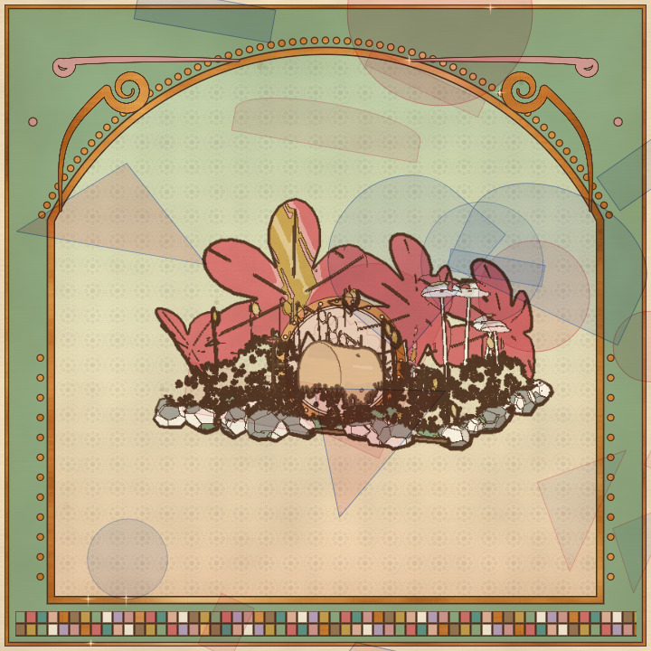
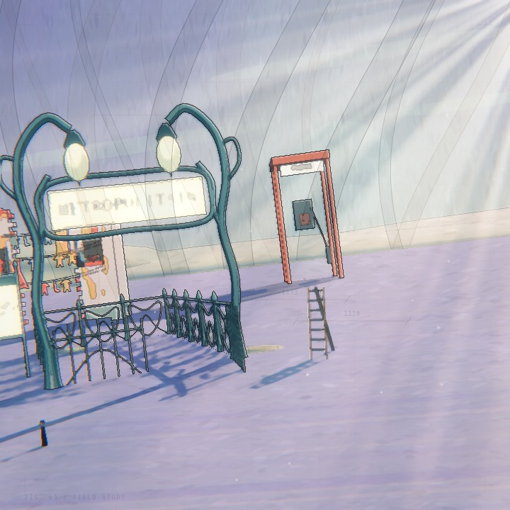
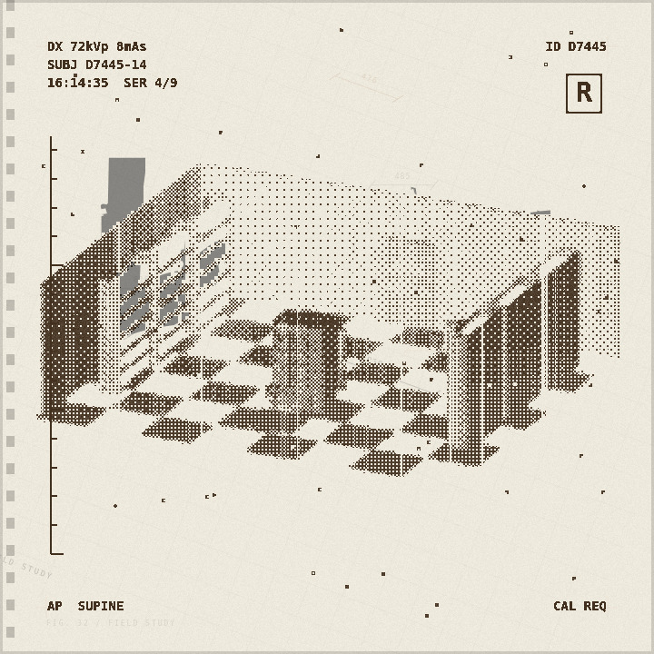
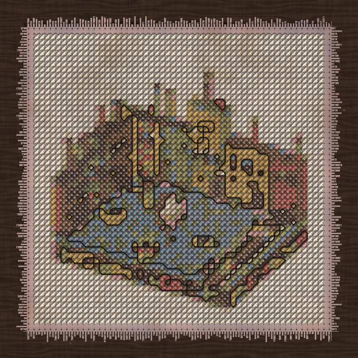
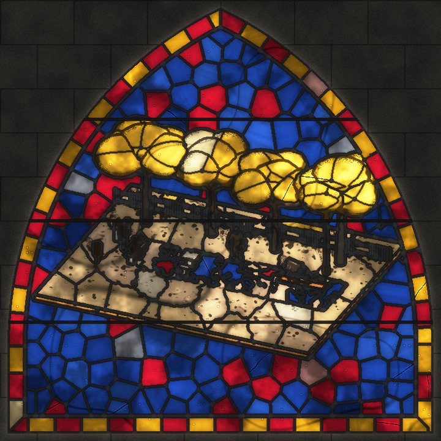
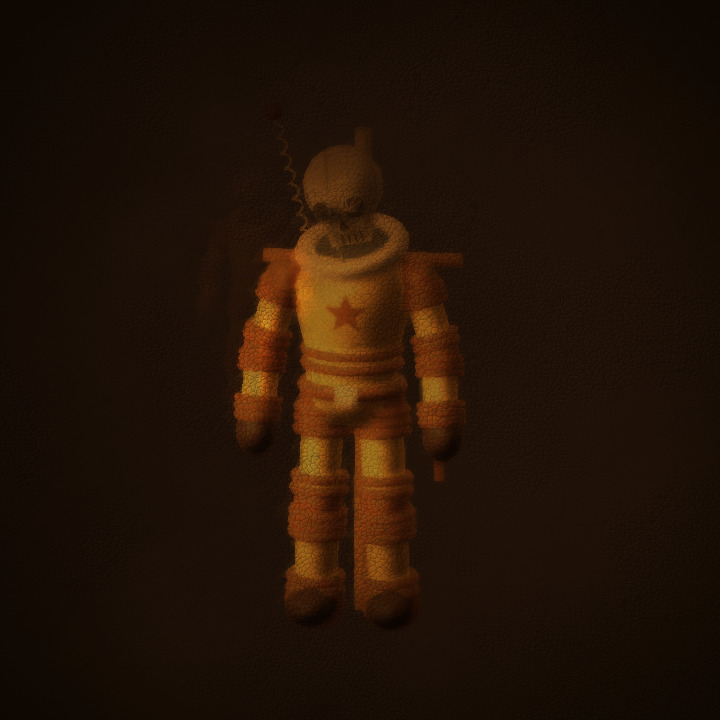
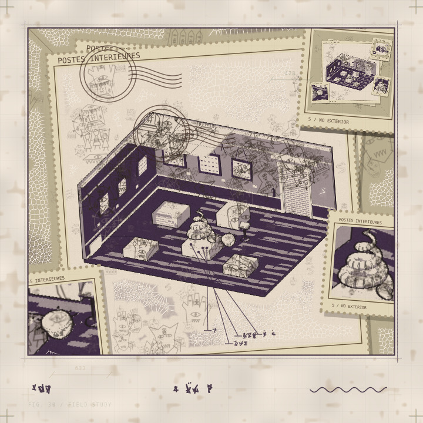
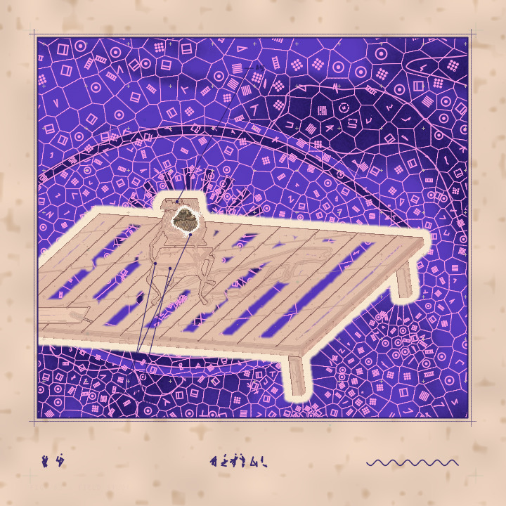

# Gallery

Eight prints from the studio's own gallery, October 2026. Every one came from a typed sentence
and the decisions the model made under it; nothing was hand-adjusted. The last two followed the
Fifth World direction (the specimen plate, the cell growth in the dead space); the rest were made
before directions existed, under the base brief.

| | Idea | World | Look |
| --- | --- | --- | --- |
|  | punk in the pink castle | moss forest floor | illuminated gold |
|  | a neon noodle shop in the rain | desert of giant features | anime light |
|  | suspect in custody | archive hall | thermal scan |
|  | A record player and a worn chair share a room at closing time… | clockwork city square | cross-stitch |
|  | A record player and a worn chair share a room at closing time… | chess park under plane trees | stained glass |
|  | oil skull portrait | Boötes void | old master light |
|  | A butterfly lands beside an ancient shell in a private specimen collection… | museum of never-was | postage from within, Fifth World |
|  | curses | worktable | ink atlas, Fifth World |

The studio keeps every generation it makes under `.data/gallery/<day>/` with its full decision
tree, and serves them at `/gallery`.
